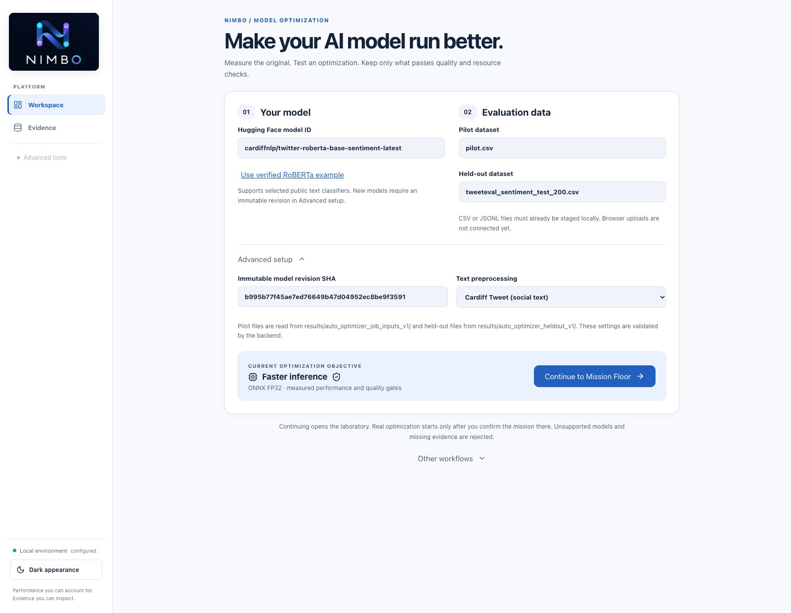
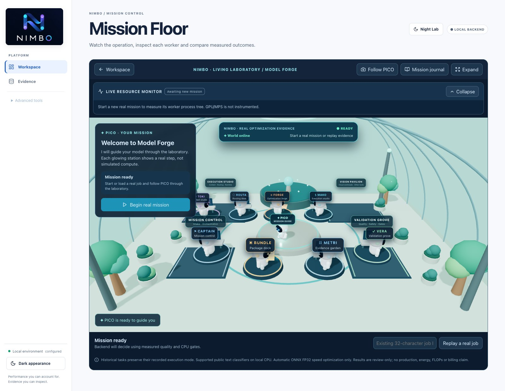
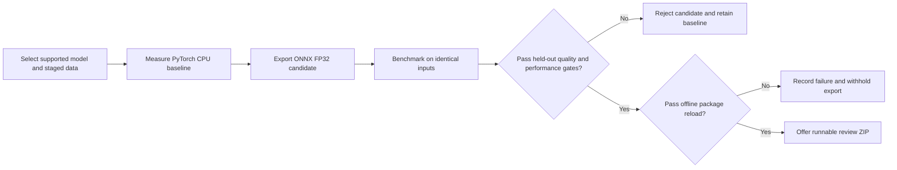
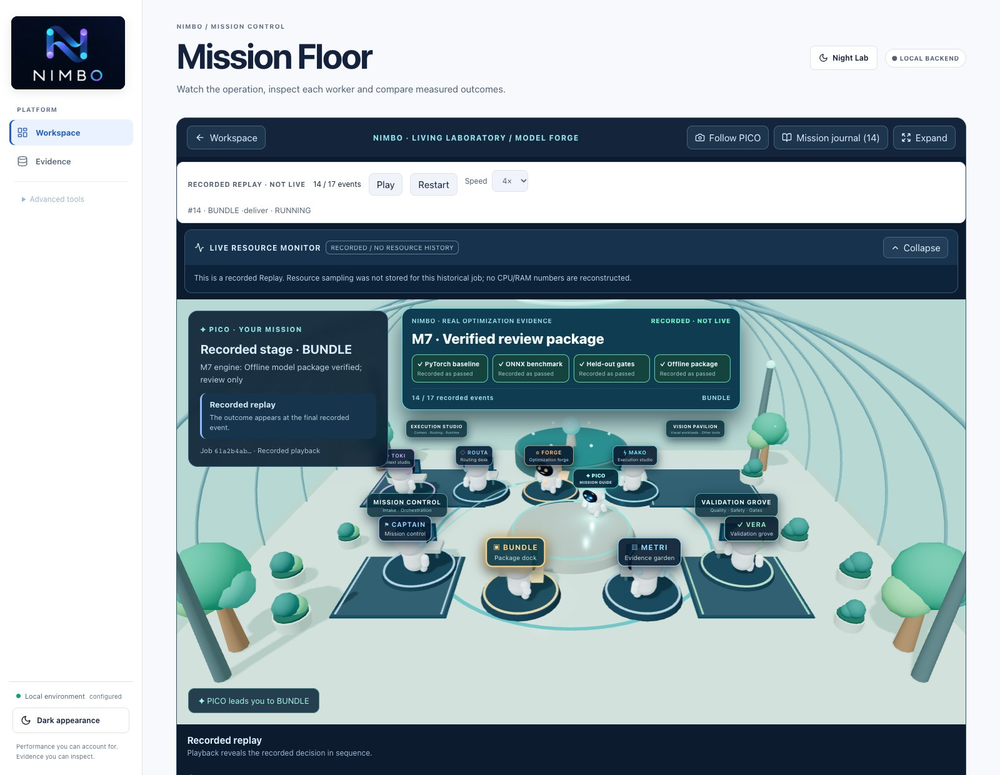
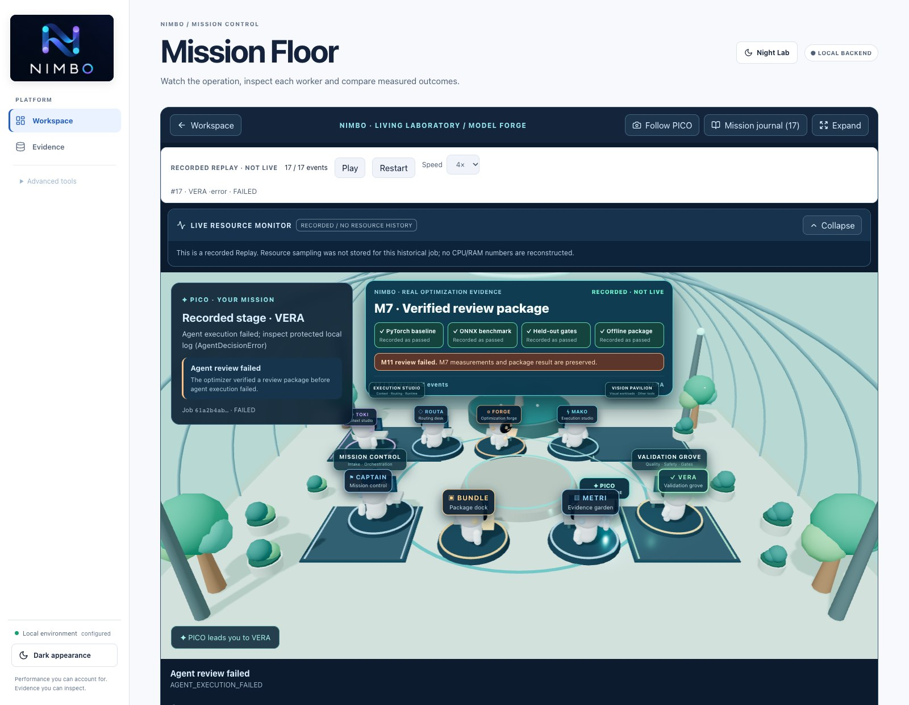

# NIMBO — Neural Intelligence for Multimodal Budget Optimization

**Improve AI model execution while preserving acceptable task quality.**

A faster runtime is useful only if it still produces reliable predictions. NIMBO takes a supported text classifier, measures its PyTorch baseline, exports the same weights to ONNX, and compares both runtimes on labeled data. If the candidate passes the quality and performance gates, NIMBO verifies a runnable review package offline. Otherwise it keeps the original model as the reference and records why the candidate was rejected.

NIMBO started during the HUMAIN Hackathon's 'Deliver AI with Less Compute' challenge and has continued as an independent AI engineering project.

[Run NIMBO in Google Colab](https://colab.research.google.com/github/LeenAlaslani/NIMBO/blob/8de511a6f9e1b01ad5dfcc1c58216d54fd0b6483/notebooks/NIMBO_Real_Optimization.ipynb) on a free CPU runtime. The notebook runs a fresh PyTorch-to-ONNX comparison on pinned public SST-2 data, displays the measured results, and offers a verified ZIP if the candidate passes. [Notebook validation](docs/NIMBO_CURRENT_STATE.md#free-cpu-review-2026-11-18)



*Workspace with the pinned model and staged evaluation files.*



*Future Garden Mission Floor, ready for a model job.*

## Optimization workflow



The held-out gate requires at least 5% lower mean warm forward latency, no p95 or process CPU-time regression, no accuracy loss, full prediction agreement, and bounds on logit differences and repeatability. A successful package contains the ONNX graph, tokenizer, model configuration, file hashes, a verification receipt and a Python runner.

## Recorded results

| Model and evaluation | Accuracy, PyTorch → ONNX | Mean warm forward latency | Process CPU time | Evidence |
| --- | ---: | ---: | ---: | --- |
| DistilBERT SST-2, 240 validation examples, three paired rounds | 90.83% → 90.83% | 62.27% lower | 45.71% lower | [Recorded optimizer run and package audit](docs/NIMBO_CURRENT_STATE.md#recorded-distilbert-optimizer-run) |
| DistilBERT IMDb, 800 IMDb test examples, three paired rounds | 91.75% → 91.75% | 14.79% lower | 2.54% lower | [IMDb run summary](docs/FINAL_JUDGING_EVIDENCE.md) |
| Same IMDb model on 800 binary TweetEval test examples | 82.88% → 82.88% | 61.79% lower | 52.72% lower | [Cross-domain run summary](docs/CROSS_DOMAIN_PUBLIC_EVIDENCE.md) |

These are local CPU measurements from separate recorded runs. Warm forward latency excludes tokenization, model startup and HTTP overhead. Process CPU time is a separate measure. Results depend on the hardware, thread settings and input data.

The recorded SST-2 optimizer completed and verified a review ZIP at event 14. Its enclosing agentic job failed during review at event 17. Replay shows both outcomes at their recorded checkpoints.



*Recorded Replay at event 14, when the optimizer verified the review package.*

<details>
<summary>Resource Monitor screenshot</summary>



*Resource Monitor at event 17, with no recorded CPU or RAM history.*

</details>

## Architecture

- **Workspace and Mission Floor** use React, JavaScript, CSS, Vite, Three.js and React Three Fiber. The UI polls backend job status and events. Replay reads saved events without starting inference.
- **Local API and job runner** use Python and FastAPI. A single-worker subprocess runs the deterministic optimizer and writes job events, decisions and evidence to ignored `results/` folders.
- **Optimizer and export** use Hugging Face Transformers and PyTorch for intake and the baseline, ONNX for export, and ONNX Runtime for CPU benchmarking and offline reload.
- **Resource Monitor** uses psutil to sample the worker process tree and host CPU/RAM while the UI is open. Ollama is sampled separately. GPU/MPS telemetry and persisted resource history are outside its current scope.

### Optional agents

| Agent | Responsibility |
| --- | --- |
| CAPTAIN | Checks the request and scopes it to the supported speed objective. |
| FORGE | Starts the deterministic ONNX optimization pipeline. |
| VERA | Reviews measured quality and offline package evidence. |
| METRI | Records the evidence verdict for review. |
| DOCTOR | Can request one retry after a classified transient infrastructure failure. |

These roles use separately prompted local Ollama calls when enabled. Deterministic checks control candidate and package eligibility. MAKO, BUNDLE, TOKI and ROUTA represent stations in the UI, and PICO is the guide.

## Quick start

Use Python 3.11 and Node.js 22 on macOS or Linux. The local worker depends on POSIX process and file-locking APIs. Run the backend from the repository root so it can find staged files and local receipts.

```bash
git clone -b develop/auto-optimizer-v1 https://github.com/LeenAlaslani/NIMBO.git
cd NIMBO
python3.11 -m venv .venv
source .venv/bin/activate
python -m pip install -e '.[api]'
python -m uvicorn app.mission_api:app --host 127.0.0.1 --port 8005
```

In a second terminal, from the clone:

```bash
cd app/web
npm ci
npm run dev -- --port 5173 --strictPort
```

Open `http://127.0.0.1:5173`. Choose **Enter workspace → Use verified RoBERTa example → Continue to Mission Floor** to explore the lab without model downloads, staged data or Ollama. **Begin real mission** submits a job. Replay requires a job ID from this checkout's local records. The screenshots use records from the development machine.

Vite proxies `/api` and `/nimbo` to the one local API in dev and preview. Set `NIMBO_API_TARGET=http://127.0.0.1:<port>` when starting Vite if you changed the backend port.

### Run a real supported optimization job

Install the model runtime dependencies in the backend environment. Stage a labeled pilot of 2–100 examples and a separate held-out set of 200–800 examples. Use UTF-8 CSV with `text,label` columns or JSONL with those keys. Labels must match the model's configured names or class IDs.

| Input | Stage under |
| --- | --- |
| Pilot | `results/auto_optimizer_job_inputs_v1/` |
| Held-out | `results/auto_optimizer_heldout_v1/` |

To prepare the public-data example on a fresh clone, run these commands from the repository root:

```bash
python -m pip install -e '.[optimizer,text]'
python -m tools.prepare_real_pilot_dataset_v1 \
  --output results/auto_optimizer_job_inputs_v1/pilot.csv
python -m tools.prepare_nimbo_tweeteval_holdout_v1
```

This stages a 12-example IMDb pilot and a 200-example TweetEval sentiment evaluation with provenance sidecars. The Workspace example selects a pinned CardiffNLP RoBERTa revision and TweetEval preprocessing. Start the API using the same environment, open the example in Mission Floor and choose **Begin real mission**. The first run downloads the model and tokenizer unless cached. The CPU run can take time and may reject the candidate on your machine. TweetEval also informed the source model's training, so use an independently collected evaluation set for a new quality claim. [IMDb dataset](https://huggingface.co/datasets/stanfordnlp/imdb) · [TweetEval dataset](https://huggingface.co/datasets/cardiffnlp/tweet_eval) · [Pinned RoBERTa files](https://huggingface.co/cardiffnlp/twitter-roberta-base-sentiment-latest/tree/b995b77f45ae7ed76649b47d04952ec8be9f3591)

For a shorter CPU check with the staged pilot, run the following baseline alone:

```bash
python -m tools.run_nimbo_baseline_v1 \
  --model-id cardiffnlp/twitter-roberta-base-sentiment-latest \
  --revision b995b77f45ae7ed76649b47d04952ec8be9f3591 \
  --dataset results/auto_optimizer_job_inputs_v1/pilot.csv
```

### Enable local Qwen agents

The standard optimizer runs by default. To enable agents, start Ollama locally, make the model available, and start the backend with the model name set:

```bash
ollama pull qwen2.5:3b
NIMBO_AGENTIC_MODEL=qwen2.5:3b \
  python -m uvicorn app.mission_api:app --host 127.0.0.1 --port 8005
```

Run `ollama serve` if Ollama is not already serving locally. Check `/nimbo/agentic/ready` before starting the mission. An unconfigured or unavailable model leaves Workspace on the standard deterministic route. Agent review can still fail after successful optimization.

### Run tests

```bash
python -m pip install -e '.[dev]'
python -m pytest -q
python -m tools.verify_public_proof_v1
python -m tools.verify_cross_domain_public_v1
npm --prefix app/web ci
npm --prefix app/web test
npm --prefix app/web run build
```

These checks run without model weight downloads, Ollama inference or local job history. The two evidence commands check the published summary files. [Release verification](docs/NIMBO_CURRENT_STATE.md#portfolio-release-verification)

## Support and next steps

Import currently covers compatible public BERT, DistilBERT, RoBERTa, ALBERT and ELECTRA sequence classifiers at an immutable Hugging Face revision. Intake requires safetensors weights within the 750 MiB cap and disables remote model code. The automatic path optimizes speed with ONNX FP32 on a single local CPU worker. Browser uploads into this path, arbitrary model formats, automatic INT8, authenticated hosting and production deployment are outside the current scope. The recorded metrics cover latency and process CPU time. Energy, FLOPs and billing were outside the measurement scope.

Next steps are direct evaluation-file staging from Workspace, a clean-machine run with an independently assembled evaluation set, and broader package and CPU measurements across supported architectures. Quantization remains a separate experiment with its own quality gates.

[Current state and milestone history](docs/NIMBO_CURRENT_STATE.md) · [Earlier experiment reproduction](docs/REPRODUCE_RESULTS.md)
